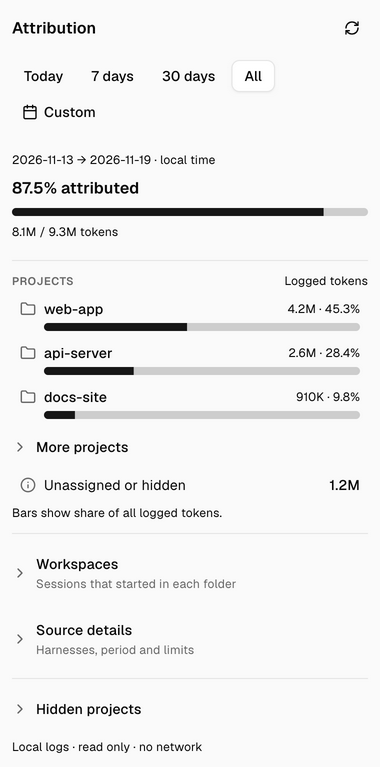

# Attribution for Orca

Orca already shows every agent and worktree in one place. Attribution adds the per-project token overview: how many Claude Code and Codex tokens each project used, read from the logs on your machine. It makes no network calls.



## Install

Requires Orca 1.4.246 or later. On 1.4.246 the panel counts tokens but cannot name projects by Orca workspace; 1.4.247 adds that.

```sh
orca plugin install Morkeeth/orca-attribution-plugin --json
```

Orca lists the access the plugin asks for (below) and prints an approval command. Run that command to approve. Then open the panel with the `pluginKey` the install printed:

```sh
orca plugin open <pluginKey> --json
```

To remove it: `orca plugin uninstall <pluginKey> --json`.

## How a session gets its project

Each session counts toward one project, picked in this order:

1. **A `PROJECT:` line.** If a message in the session starts with `PROJECT: <name>`, the whole session counts toward that name, including turns before the line and subagent logs of the same session. Only the opening line of a message counts, so quoted instructions are ignored. Anything after a `·` on that line is ignored.
2. **The folder the session started in.** If that folder is inside an Orca workspace, the workspace name is used. If not, the name of the git repository that contains it. Later `cd` commands do not move the session.
3. **Otherwise unassigned.** A session started in your home folder with no `PROJECT:` line is shown as unassigned. It is never guessed.

The **Hidden projects** setting starts empty. Open **Hidden projects** in the Attribution panel, enter comma-separated words, and select **Save**. The plugin counts matching project names or start folders as unassigned and hides matching workspace rows. Clear the setting to show those projects again.

## What the numbers are

- Claude Code: input, output, cache-read and cache-creation tokens of each assistant message, counted once per message id.
- Codex: the increase in the session's running `total_tokens`. A counter reset starts a new baseline.
- Bars show each project's share of all logged tokens, unassigned included.
- These are logged token counts. They do not measure time, output or money. The two tools use different tokenizers.
- Dates are local calendar days. Today, 7 days, 30 days, All and custom ranges filter by day.
- Workspace totals count only sessions that started in exactly that folder. A home folder, a folder that appears twice, or a remote workspace shows **Unknown**.

## Access and data

The plugin uses the `trusted-worker` profile because it reads files in your home folder. Panels run in a sandboxed frame and cannot read files, so a Node worker is the only way to read the logs.

| Access | Why |
| --- | --- |
| `workspace:read` | Lists your Orca workspaces with `workspace.list` to name projects by workspace, and receives `workspace.created` and `workspace.removed` to refresh the panel. |
| `settings:own` | Stores the Hidden projects setting. |

What the worker does:

- It reads `~/.claude/projects/**/*.jsonl` and `~/.codex/sessions/**/*.jsonl`. For each session it walks up from the start folder to find a `.git` entry.
- It writes one cache file, `~/.cache/orca-attribution/usage-v2.json` (mode 600). The file holds token counters, dates, session ids, start folders and `PROJECT:` names, so unchanged logs are not read again. It never stores message text.
- It makes no network requests and runs no other programs. The source imports only `node:fs`, `node:path`, `node:os` and `node:readline`.
- It reads at most 64 MiB of new log data at a time, newest files first. While older history is still loading, the open panel says the counts are partial and reads again every 2 seconds until it is done.

To remove the cache: `rm -r ~/.cache/orca-attribution`.

## Development

```sh
orca plugin types . --json
npm ci --ignore-scripts && npm run typecheck && rm -rf node_modules
orca plugin test . --json
orca plugin check . --json
orca plugin validate . --json
```

Remove `node_modules` after typechecking. Orca refuses executable symlinks in plugin content, even gitignored ones.

The tests build throwaway home folders with sample logs in both formats. They cover partial lines, cache restarts, Codex counter resets, `cd` during a session, subagent logs, a large Claude history read alongside a small Codex one, hidden names and date ranges.

`src/panel.check.ts` holds a `sample` scenario with made-up data. The screenshot comes from `orca plugin shot . --scenario sample`, which needs the Orca window minimized.

## Licence

MIT. See [LICENSE](LICENSE).
